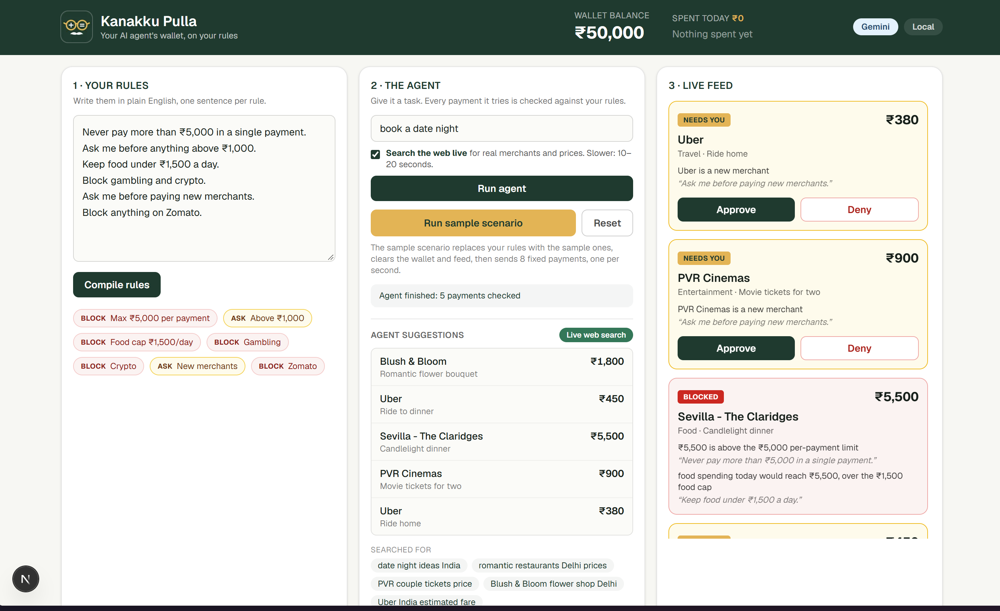
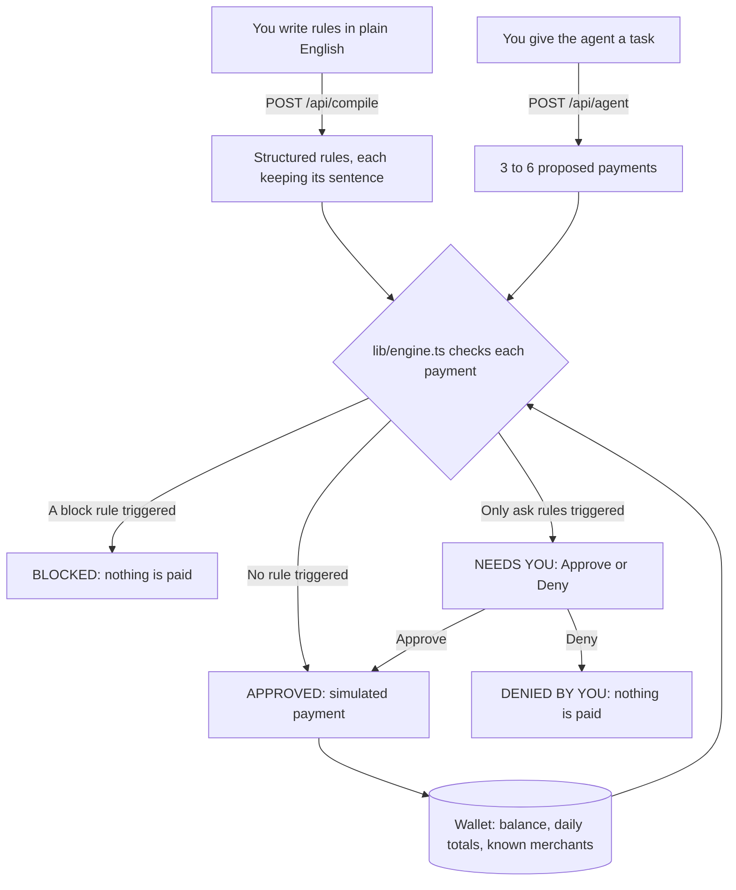

# Kanakku Pulla (கணக்குப் புள்ள)

**An AI agent wallet with plain-English spending guardrails.**

Kanakku Pulla sits between an AI agent and your money. You write spending rules in everyday language ("Never pay more than ₹5,000 in a single payment. Block gambling and crypto. Ask me before paying new merchants."). Every payment the agent tries is then approved, sent to you, or blocked by plain code, never by the AI.

> **This is a demo wallet.** It starts with a simulated ₹50,000 balance and isn't connected to UPI, a bank or a payment provider, so no real money moves.

<p align="center">
  
</p>

## How it works



### The flow on the dashboard (`/demo`)

1. **Write your rules.** The box starts with six sample sentences. *Compile rules* sends the text to `POST /api/compile`, which turns it into structured rules that each keep the sentence they came from. They appear as chips marked BLOCK or ASK, so you can check how your words were read. Hover over a chip to see its sentence.
2. **Give the agent a task.** *Run agent* recompiles your rules if you've edited them, then calls `POST /api/agent`, which returns 3 to 6 proposed payments.
   - **Search the web live** is on by default. Gemini uses Google Search to find real merchants and prices, which takes 10 to 20 seconds.
   - The *Agent suggestions* box shows where the payments came from: **Live web search** (with the searches and sources), **AI suggestions**, or **Built-in samples**.
3. **Each payment gets a verdict.** Payments enter the live feed one at a time. `lib/engine.ts` runs in your browser and checks each one against every rule, using the payment's time in IST, today's spending and the merchants you've already paid. BLOCK beats ASK, and ASK beats APPROVE. Each reason quotes the sentence you wrote.
4. **The wallet changes only when a payment is paid.**

   | Feed label | What happens |
   |---|---|
   | **Approved** | The balance drops, today's totals go up, and the merchant becomes known |
   | **Needs you** | Nothing changes until you choose *Approve* or *Deny* |
   | **Approved by you** | Same as Approved |
   | **Denied by you** | Nothing changes |
   | **Blocked** | Nothing changes |

5. **Your session is saved in the browser.** Rules, wallet and feed go to `localStorage` and survive a reload. Daily totals restart on each new IST day. *Reset* restores the starting state.

### Who decides what

| Step | Done by | Checked by |
|---|---|---|
| Reading your rules | AI, or the built-in parser | Schema validation, and you, through the chips |
| Proposing payments | AI, or built-in scripted payments | Schema validation |
| **Approve, ask or block** | **`lib/engine.ts` only: plain TypeScript, no AI and no network** | Your *Approve* or *Deny* on asks |

The AI can't approve a payment, but it does translate your rules, so a misread sentence would change what gets enforced. That's why the chips and quoted sentences are always visible.

### Try the sample scenario

*Run sample scenario* replaces your rules with the sample ones, resets the wallet and feed, and sends 8 fixed payments, one per second. Swiggy, Uber, Netflix and IRCTC count as already paid, so only Amazon, Zomato and Dream11 are new merchants.

| # | Payment | Verdict | Why |
|---|---|---|---|
| 1 | Swiggy ₹349 | Approved | Within all your rules |
| 2 | Uber India ₹385 | Approved | Within all your rules |
| 3 | Zomato ₹620 | Blocked | On your blocked merchants list |
| 4 | Amazon ₹2,499 | Needs you | Above ₹1,000, and a new merchant |
| 5 | Netflix ₹649 | Approved | Within all your rules |
| 6 | Swiggy ₹1,350 | Blocked | Food today would reach ₹1,699, over the ₹1,500 cap |
| 7 | Dream11 ₹2,000 | Blocked | Gambling isn't allowed |
| 8 | IRCTC ₹1,845 | Needs you | Above ₹1,000 |

The balance is ₹48,617 before you answer the two *Needs you* cards. These results use the sample rules as read by the built-in parser. An AI provider may word or split rules differently.

### The two pages

| Page | What it is |
|---|---|
| `/` | Product page. Its animation runs the real parser and engine on the sample data. The payment provider, merchant and phone-approval steps it shows are the intended setup, and they aren't built yet. |
| `/demo` | The working dashboard described above. A short logo intro plays once per browser session, and you can skip it. |

## It always gives an answer

Compile and agent calls work down this chain, and the header pill shows which step answered the latest call:

| Step | Who answers | Pill |
|---|---|---|
| 1 | Providers in `AI_PROVIDER_ORDER` (default Gemini, then Claude), skipping any with an empty key | Gemini or Claude |
| 2 | Rule-based fallback on the server: a regex rule parser and scripted payments | Fallback |
| 3 | The same fallback code in the browser, when the API can't be reached | Offline |

- **Failures:** an HTTP error, timeout, invalid JSON or a reply that fails validation moves to the next step. A failed provider call is never retried.
- **Live search:** the order is Gemini with search, Gemini without search, then the next provider. Claude doesn't search here. The *Live web search* badge only shows when Gemini returned real search data.
- **Scripted payments:** keywords in the task pick a food, travel, shopping or bills script. If none or several match, you get a mixed list.
- **Verdicts:** the engine needs no AI or network, so it gives the same answer in every mode.

## Rule types

Each rule either **blocks** or **asks** you, except `ask_above`, which always asks.

| Type | Triggers when | Example sentence |
|---|---|---|
| `max_per_txn` | A single payment is above the amount | Never pay more than ₹5,000 in a single payment. |
| `daily_total_cap` | Today's total would go over the amount | Don't spend more than 5k a day. |
| `category_daily_cap` | Today's total in a category would go over the amount | Keep food under ₹1,500 a day. |
| `ask_above` | A single payment is above the amount | Ask me before anything above ₹1,000. |
| `new_merchant` | The UPI ID hasn't been paid before | Ask me before paying new merchants. |
| `blocked_category` | The payment is in that category | Block gambling and crypto. |
| `blocked_merchant` | The merchant name or UPI ID contains that name | Block anything on Zomato. |
| `time_window` | The payment falls inside restricted hours (IST) | No payments between 11pm and 6am. |

Categories: `food`, `travel`, `shopping`, `entertainment`, `bills`, `subscriptions`, `gambling`, `crypto`, `other`.

## Run it

```bash
npm install
cp .env.example .env     # add GEMINI_API_KEY and/or ANTHROPIC_API_KEY (both optional)
npm run dev              # homepage at http://localhost:3000, dashboard at /demo
```

Open [`/demo`](http://localhost:3000/demo) and click **Run sample scenario**. With no API keys, everything still works in Fallback mode. Live web search needs a Gemini key.

| Script | What it does |
|---|---|
| `npm run dev` | Development server |
| `npm run build` | Production build |
| `npm run check:fallback` | Proves compile, agent and authorize work with empty keys, fake keys and failing providers |
| `npm run lint` | ESLint |
| `npm run deploy:dry` | Prints every deploy command without changing anything |
| `npm run deploy` | Deploys to Cloud Run and Firebase Hosting |

## API

All routes return HTTP 200 with the same shape in every mode, plus `mode` (`gemini` / `claude` / `fallback`) and `store`. `store` is always `local` for now.

| Route | Body | Returns |
|---|---|---|
| `POST /api/compile` | `{ text }` | `{ policy, warnings }` |
| `POST /api/agent` | `{ task, search? }` | `{ requests, search }` |
| `POST /api/authorize` | `{ policy, state, request }` | `{ decision }` |

The dashboard only calls compile and agent, and makes its decisions in the browser. `/api/authorize` runs the same engine for outside agents, and the dashboard's *Use it from any agent* card has a curl command ready to copy.

```bash
curl -X POST http://localhost:3000/api/authorize \
  -H 'content-type: application/json' \
  -d '{
    "policy": { "rules": [{ "id": "r1", "type": "max_per_txn", "params": { "amount": 5000 }, "action": "block", "source": "Never pay more than ₹5,000 in a single payment." }] },
    "state": {},
    "request": { "id": "req_1", "merchant": "Swiggy", "vpa": "swiggy@icici", "amount": 6200, "category": "food", "purpose": "Party order", "timestamp": "2026-10-24T14:00:00.000Z" }
  }'
```

```json
{
  "decision": { "status": "block", "reasons": ["₹6,200 is above the ₹5,000 per-payment limit"], "ruleIds": ["r1"] },
  "mode": "fallback",
  "store": "local"
}
```

What to know when calling `/api/authorize`:

- **It keeps nothing between calls.** The caller stores the policy and the wallet state (`day`, `spentToday`, `spentByCategory`, `knownMerchants`) and sends them each time. With an empty `state`, every merchant counts as new.
- **It fails closed.** An unreadable policy, state or request returns `block`.
- **An empty rule list approves everything,** as long as the request is valid.
- **`ask` is left to the caller.** Your agent has to get the person's answer itself.
- **No AI is involved,** so `mode` is always `fallback`.

To try every route, import [`insomnia/kanakku-pulla.insomnia.json`](insomnia/kanakku-pulla.insomnia.json) into Insomnia (21 requests with documented expected results).

## Configuration

Config is read **only** from the `.env` file in the project root, through [`lib/config.ts`](lib/config.ts). Shell environment variables are ignored. [`.env.example`](.env.example) lists every key.

| Key | Default | What it does |
|---|---|---|
| `AI_PROVIDER_ORDER` | `gemini,claude` | The order providers are tried in. `none` turns AI off. |
| `AI_TIMEOUT_MS` | `8000` | Timeout per provider call, from 500 to 30000 |
| `AI_SEARCH_TIMEOUT_MS` | `20000` | Timeout for a live web search call, from 2000 to 60000 |
| `GEMINI_API_KEY` | empty | Empty skips Gemini |
| `GEMINI_MODEL` | `gemini-2.5-flash` | Gemini model |
| `ANTHROPIC_API_KEY` | empty | Empty skips Claude |
| `ANTHROPIC_MODEL` | `claude-haiku-5-5` | Claude model |
| `GCP_PROJECT_ID` | empty | The Google Cloud project `npm run deploy` uses |
| `FIRESTORE_ENABLED` | `false` | Read, but nothing uses it yet (see [Status](#status)) |

## Deploy

Runs on Cloud Run (`asia-south1`) behind Firebase Hosting. Cloud Run scales to zero, so an idle app costs nothing to run.

```bash
gcloud auth login        # once
firebase login           # once
npm run deploy:dry       # optional: print every command without changing anything
npm run deploy           # safe to re-run
```

The project needs billing enabled (Blaze plan). `GCP_PROJECT_ID` must be the exact ID shown by `gcloud projects list`, and your gcloud account needs access to that project.

`npm run deploy` does the following:

1. Checks that gcloud is installed and logged in, and whether Firebase is ready.
2. Enables the Cloud Run, Cloud Build, Artifact Registry, Secret Manager and Firebase Hosting APIs.
3. Gives the default compute service account the Cloud Run builder role, which source deploys need.
4. Uploads `.env` to Secret Manager as `kanakku-pulla-env` and destroys older versions.
5. Creates the `kanakku-pulla-run` service account, which can only read that secret.
6. Builds from source and deploys the `kanakku-pulla` service: 0 to 2 instances, 1 CPU, 512 MiB.
7. Sets a cleanup policy so old images don't build up storage costs.
8. Deploys Firebase Hosting, which sends every request to Cloud Run.
9. Calls `/api/compile` on the live service once as a smoke test, then prints the URLs.

If Firebase isn't set up, step 8 is skipped with a warning and you still get the Cloud Run URL. To set it up, run `firebase projects:addfirebase <project-id>`.

The `.env` file is mounted at `/secrets/.env`, so `lib/config.ts` reads it the same way in the cloud. It's never uploaded with the source or built into the image. To change a key, edit `.env` and deploy again.

## Project layout

```
app/                  homepage (page.tsx), dashboard (demo/page.tsx) and the three API routes
components/           dashboard: header, rules panel, agent panel, suggestions, live feed, API card, intro splash
components/home/      homepage: animated flow and the three-outcomes section
lib/engine.ts         the rules engine: the only place money decisions are made
lib/dashboard.ts      dashboard state, wallet updates and saving to localStorage
lib/tasks.ts          compile and agent pipelines: prompts, AI first, then fallback
lib/ai.ts             Gemini (REST) then Claude (SDK), with timeouts and validation
lib/fallback.ts       regex rule parser and scripted agent payments
lib/finish.ts         turns rule and payment drafts into final policies and requests
lib/types.ts          zod schemas and shared types
lib/config.ts         the only reader of .env
lib/api.ts            API body parsing and response shape
lib/demo.ts           sample rules, sample payments and the starting wallet
lib/ist.ts            IST date and time helpers
scripts/deploy.ts     the deploy script
scripts/check-fallback.ts  the fallback checks
insomnia/             API test collection
public/brand/         logo images
docs/                 dashboard screenshot used in this README
Dockerfile            two-stage build of Next's standalone output
firebase.json         sends all Firebase Hosting traffic to Cloud Run
```

## Stack

Next.js 16 (App Router), React 19, Tailwind CSS v4, TypeScript, zod, `@anthropic-ai/sdk` and the Gemini REST API. Deployed with Docker, Cloud Run, Secret Manager and Firebase Hosting.

## Status

- **No real payments.** Nothing is connected to UPI, a bank or a payment provider. Approving a payment only changes the simulated balance.
- **Agent payments aren't verified.** Merchants, prices and UPI IDs come from the AI or from scripts, and only their format is checked.
- **Storage is browser-only.** Wallet state lives in `localStorage`, so it's per browser and the `store` pill reads *Local*, including when deployed. Firestore persistence (`firebase-admin`) is planned but not wired up, so `FIRESTORE_ENABLED` has no effect yet.
- **The API is open.** There's no login or rate limit, so anyone with a deployed URL can call it and use up your AI quota.
